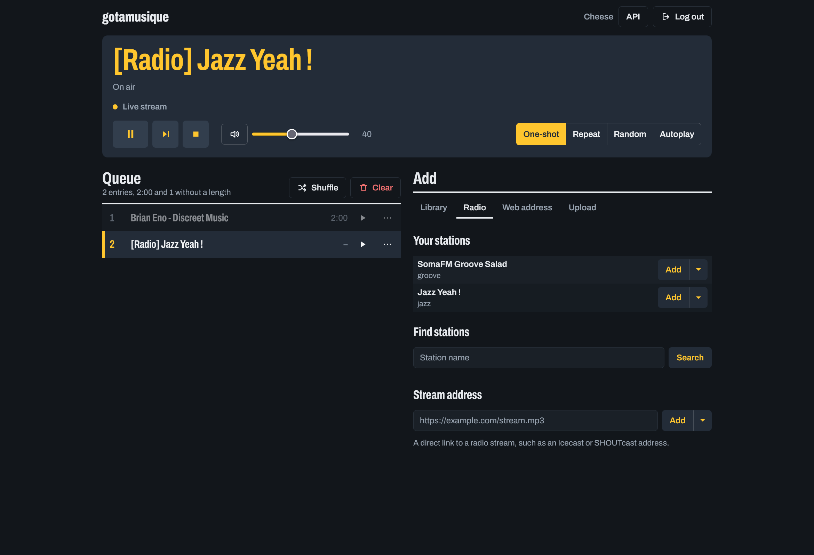

# gotamusique

A Go rewrite of [botamusique](https://github.com/azlux/botamusique), a Mumble music bot. Single self-contained
binary, no Python runtime required.



📖 **Documentation: <https://creadicted.github.io/gotamusique/>**

- [Installation](https://creadicted.github.io/gotamusique/installation/): binary, Docker, requirements
- [Configuration](https://creadicted.github.io/gotamusique/configuration/): every INI section and key
- [Commands](https://creadicted.github.io/gotamusique/commands/): chat command reference
- [Migrating from botamusique](https://creadicted.github.io/gotamusique/migrating/)

## Download

Pre-built Linux binaries (dynamically linked against `libopus`) are published automatically on every commit to `master`:

| Platform     | Binary                    |
|--------------|---------------------------|
| Linux x86-64 | `gotamusique-linux-amd64` |

Download from the [latest release](../../releases/tag/latest). For stable versioned releases see the
[Releases](../../releases) page. A Docker image is published to
`ghcr.io/creadicted/gotamusique` on every `v*` tag.

## Quick start

Requires `ffmpeg` on PATH (see [Installation](https://creadicted.github.io/gotamusique/installation/) for the full list).

```sh
chmod +x gotamusique-linux-amd64

cat > configuration.ini <<'EOF'
[server]
host = mumble.example.com
channel = Music

[bot]
username = gotamusique
admin = YourMumbleUsername

[radio]
jazz = http://jazz-wr04.ice.infomaniak.ch/jazz-wr04-128.mp3 "Jazz Yeah!"
EOF

./gotamusique-linux-amd64
```

The bot connects, joins the configured channel, and waits for commands in Mumble chat (`!radio jazz`, `!help`).

## Development

```sh
git clone https://github.com/creadicted/gotamusique
cd gotamusique
make build         # produces bin/gotamusique
make test          # run all tests
make docker-build  # docker build -t gotamusique .
```

Documentation lives in [`docs/`](docs/) and is built with [MkDocs Material](https://squidfunk.github.io/mkdocs-material/):

```sh
uvx --with-requirements docs/requirements.txt mkdocs serve   # live preview at http://127.0.0.1:8000
```

### Publishing a versioned release

1. Bump the version constant in `cmd/gotamusique/main.go`.
2. Commit, push, then tag:
   ```sh
   git tag v0.1.5
   git push origin v0.1.5
   ```

CI builds the binaries and publishes a GitHub release automatically.

### Project structure

```
cmd/gotamusique/    main entrypoint
internal/
  config/           INI loading, embedded defaults, CLI flag overrides
  bot/              Bot struct, connect/reconnect loop, graceful shutdown
  audio/            ffmpeg subprocess, PCM pipeline, volume, fade; MediaItem interface
  radio/            RadioItem, RadioBrowser (radio-browser.info client)
  queue/            thread-safe play queue
  command/          dispatcher and chat command handlers
docs/               MkDocs documentation site
tasks/              milestone specs (see tasks/README.md)
ref/                original Python bot Dockerfiles (reference only, do not modify)
```

## Roadmap

See [`tasks/README.md`](tasks/README.md). Phase 1 delivers a deployable radio bot; Phase 2 adds local file playback,
yt-dlp, a web UI, and full parity with the original Python bot.
