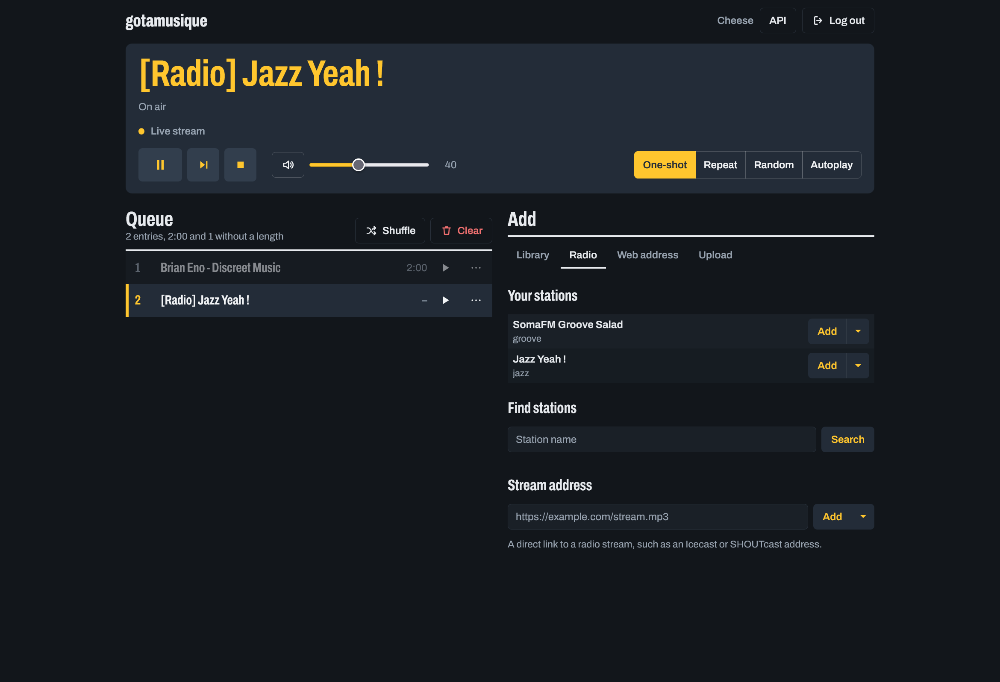

# Web interface

The bot can serve a web interface, so people in the Mumble channel can see what plays and control
it from a browser: pause and skip, change the volume, edit the queue, add radio stations and tracks,
browse the library and upload music. It works on a phone too. Behind it is an HTTP API you can
script, with [interactive documentation](#interactive-documentation-swagger-ui). It is **off by
default**: nothing listens until you enable it.



## Quick start

Five minutes, on the machine that runs the bot.

1. **Turn it on.** Add this to your `configuration.ini` and restart the bot:

    ```ini
    [webinterface]
    enabled = True
    ```

    It listens on `127.0.0.1:8181` only and asks for a login. The bot refuses to start if that port
    is already taken. Running in Docker? See [Docker](#docker) first: the bot must listen on
    `0.0.0.0` and the port must be published.

2. **Open it.** Go to `http://127.0.0.1:8181/` in a browser on the same machine. Before you log in
   it shows the steps to do so.

3. **Log in.** In the Mumble channel the bot is in, type `!web`. The bot sends you a **private
   message** with a link that works once and expires after 5 minutes. Open it and you land in the
   interface. Some clients, such as Kallisti, show chat as plain text; the link is written out in
   full, so copy it into the address bar. (For a quick local test only, `auth_method = none` skips the login; read
   [No login](#no-login-auth_method-none) before using it anywhere else.)

4. **Play something.** The default config has a `jazz` station: open **Radio** and press **Add**.
   You hear it in Mumble, so be in the bot's channel. For your own music set `music_folder` (see
   [Music library](library.md)); it appears under **Library**, and **Upload** adds files from your
   computer.

**No Mumble server at hand?** From a source checkout, `make ui-demo` starts the interface with a
fake bot and made-up music, to look around. Nothing is played or stored. `make ui-demo LOGIN=1`
shows the `!web` login flow instead of skipping it. To try the real bot with a real server, run
`make playground` (or `make playground-kallisti` for a browser as the Mumble client, with nothing to
install); see `playground/README.md`.

**Reaching it from other machines.** Keep the bot on loopback and put a reverse proxy in front
(see [Reverse proxy and TLS](#reverse-proxy-and-tls)), then set `access_address` to the proxy's
public URL: the `!web` link is built from it, so with the default it would point at
`127.0.0.1`, which only works on the bot's own machine.

**It does not work?**

- The page says "Log in with the bot": you are not logged in. Type `!web` in Mumble and open the link.
- The login link answers `401`: it was already used or has expired. Type `!web` again.
- "Cannot reach the bot" in a red bar: the bot stopped or the network dropped. The page keeps the
  last queue on screen and recovers by itself.
- `Connection refused`: the web interface is off or the bot is not running.
- `421 bad_host` (only without a login): `access_address` does not match the address you use.

## Using the interface

**The board** at the top shows what plays. Drag the position to seek (local files only; a live
stream shows *Live stream*). The keys pause or resume, skip to the next entry, and stop (back to the
first entry). Next to them are the volume with a mute button, and the playback mode: *One-shot*,
*Repeat*, *Random* and *Autoplay* (which needs a music library). When the track changes, the title
on the board decodes into place; this is skipped if your system asks for reduced motion.

**The queue** lists the entries in play order. The playing one is dark with an amber bar, and
entries that have finished are dimmed. The play key starts an entry; the **…** key opens *Move up*,
*Move down* and *Remove*. *Shuffle* mixes what comes next, and *Clear* asks once more before it
empties the queue. Two people can edit at once: an entry someone else already removed simply
disappears from your list, with no error.

**Add** has four sources. Every *Add* button has a menu next to it with *Play next* and *Play now*.

- **Library**: browse folders, or search. A search looks at titles, artists and folder names across
  the whole library, and tag buttons narrow it down. *Rescan* reads the music folder again.
- **Radio**: the stations from your `[radio]` config, a search on radio-browser.info, or a direct
  stream address. The search takes a station name, a **tag** (such as `jazz` or `ambient`), or both;
  the most voted stations come first and known-broken ones are left out. Each hit shows its tags.
- **Web address**: one track from a web address, through yt-dlp. Best effort, see
  [URL playback](../commands/index.md#url-playback).
- **Upload**: choose or drop audio files; they go up one at a time and can be added right away.
  See [Uploads](#uploads).

**On a phone** the board stays on top and two buttons switch between Queue and Add. The page follows
your system's light or dark setting, works with the keyboard, and gives screen readers the real
title (not the animation).

The interface loads nothing from the internet: the font and everything else are built into the bot,
and the page is served with a strict Content-Security-Policy. It does not show album art, and it
cannot download files or edit or delete library entries.

## Scripting with curl

The interface is a client of the same API you can call yourself. This is also the quickest way to
check things from a terminal (add `| jq` if you have it). Without a login the API answers `401`:

```sh
curl -i http://127.0.0.1:8181/api/v1/state     # HTTP/1.1 401, {"code":"unauthenticated", ...}
```

Log in with `curl` the same way a browser does, and keep the cookie:

```sh
curl -c cookies.txt -L 'http://127.0.0.1:8181/login?token=PASTE_THE_TOKEN_FROM_THE_LINK'
```

Then look and steer:

```sh
curl -s -b cookies.txt http://127.0.0.1:8181/api/v1/state
curl -s -b cookies.txt -X POST http://127.0.0.1:8181/api/v1/queue -d '{"type":"radio","preset":"jazz"}'
curl -s -b cookies.txt -X PUT  http://127.0.0.1:8181/api/v1/volume -d '{"volume":0.4}'
curl -s -b cookies.txt -X POST http://127.0.0.1:8181/api/v1/playback/pause
```

Every change answers with the new state. For your own music:

```sh
curl -s -b cookies.txt -X POST http://127.0.0.1:8181/api/v1/library/rescan     # scan the folder
curl -s -b cookies.txt 'http://127.0.0.1:8181/api/v1/library'                  # list it
curl -s -b cookies.txt -F file=@song.mp3 http://127.0.0.1:8181/api/v1/library/upload
```

Queue a track with `{"type": "library", "path": "<path from the listing>"}`. A call that answers
`401 unauthenticated` after you logged in is missing `-b cookies.txt` (a browser sends the cookie by
itself). For the full list of calls open `/api/docs`, see
[Interactive documentation](#interactive-documentation-swagger-ui).

## Enable it

```ini
[webinterface]
enabled = True
listening_addr = 127.0.0.1
listening_port = 8181
access_address = https://music.example.com
auth_method = token
```

| Key              | Default                 | Description |
|------------------|-------------------------|-------------|
| `enabled`        | `False`                 | Start the web interface |
| `listening_addr` | `127.0.0.1`             | Address to listen on. Loopback only by default; use `0.0.0.0` in Docker and publish the port |
| `listening_port` | `8181`                  | Port to listen on. The bot exits at startup if it is already taken |
| `access_address` | `http://127.0.0.1:8181` | The public URL people open, an absolute `http://` or `https://` URL with a host (a path is fine, credentials and a query are not). The link from `!web` is built from it. An `https://` URL marks the session cookie *Secure*. The bot refuses to start with `enabled = True` and a missing or malformed value |
| `auth_method`    | `token`                 | `token` or `none` (see below) |
| `upload_enabled` | `True`                  | Let logged-in users upload audio (see [Uploads](#uploads)) |
| `max_upload_file_size` | `30M`             | Size limit of one uploaded file: a number with an optional `K`, `M` or `G`, at most `1024G` |
| `allow_upload_without_auth` | `False`      | Also allow uploads when `auth_method = none`. Off by default: an open instance would let anyone who can reach it fill the disk |

The section name and these keys are the same as in botamusique, so an existing file loads. Its
other keys (`user`, `password`, `max_attempts`, `flask_secret`, `is_web_proxified`,
`max_upload_file_size`, `upload_enabled`, `web_logfile`) are accepted and ignored.
`auth_method = password` is **not supported** and stops the bot at startup, rather than silently
serving without the login you asked for.

## Logging in (`auth_method = token`)

1. Type `!web` in the Mumble channel.
2. The bot sends you a **private message** with a login link. The link works once and expires after
   5 minutes. Asking again invalidates the previous link, and a link that could not be sent to you
   is cancelled at once.
3. Open it. You get a session cookie (HttpOnly, SameSite=Lax) that stays valid while you use it, up
   to 12 hours idle and 7 days in total. Restarting the bot logs everyone out.

Anyone in the bot's channel can request a link, so access to the web interface is as open as
access to the channel. A user with a certificate keeps the same identity if they rename
themselves; without one the identity is the name.

## No login (`auth_method = none`)

Everyone who can reach the address controls the bot. Only use it on a network you trust. The bot
logs a warning if it listens beyond loopback in this mode, and it refuses requests whose `Host`
header is not `access_address` or a loopback name (this defends against DNS rebinding, so set
`access_address` to the address you actually use).

## Reverse proxy and TLS

The bot speaks plain HTTP. For HTTPS put a reverse proxy in front, set `access_address` to its
public URL and keep `listening_addr` on loopback:

```nginx
server {
    listen 443 ssl;
    server_name music.example.com;
    location / {
        proxy_pass http://127.0.0.1:8181;
        proxy_set_header Host $host;
    }
}
```

Forward the original `Host` header (as above). To allow uploads, also raise the proxy's body limit
to at least `max_upload_file_size` (nginx: `client_max_body_size 31m;`, its default is only 1 MB)
and its timeouts for slow uploads (`proxy_request_buffering off;` streams the file through). The bot refuses state-changing requests whose
`Origin` is a different site than the `Host` it was sent to, or than `access_address`.

## Docker

Bind to all interfaces inside the container and publish the port:

```ini
[webinterface]
enabled = True
listening_addr = 0.0.0.0
access_address = http://your-host:8181
```

```yaml
services:
  gotamusique:
    ports:
      - "127.0.0.1:8181:8181"   # drop the 127.0.0.1: to expose it to the network
```

## Interactive documentation (Swagger UI)

The bot describes its API in an [OpenAPI 3](https://spec.openapis.org/oas/v3.0.3) document and
serves an interactive page for it, so you can read every endpoint and call it from the browser:

| Address | What |
|---------|------|
| `/api/docs` | Swagger UI: every endpoint with its parameters, examples and error codes, and a **Try it out** button |
| `/api/v1/openapi.yaml` | The OpenAPI document itself, for code generators, Postman, Insomnia and similar tools |

With `auth_method = token`, both need the login: type `!web`, open the link **in your browser**, then
open `/api/docs` in the same browser. Calls made from the page use your session cookie, so
*Try it out* works against your own bot straight away. Without a login (`auth_method = none`) no
login is needed.

The page loads nothing from the internet: Swagger UI is built into the bot, and the page is served
with a strict Content-Security-Policy that allows only the bot's own scripts. No call is made on
page load except fetching the description; *Try it out* only sends what you execute, and it really
changes things (queueing, volume, uploads).

To use the description with your own tools, download it while logged in
(`curl -b cookies.txt http://127.0.0.1:8181/api/v1/openapi.yaml -o openapi.yaml`), or take
[`internal/web/openapi.yaml`](https://github.com/creadicted/gotamusique/blob/master/internal/web/openapi.yaml)
from the repository. The document is written by hand and tested against the code: a test fails if
a route, an error code or a response shape differs from it.

## API

All endpoints are under `/api/v1`, speak JSON and need a session (except in `none` mode). Errors
look like `{"error": "...", "code": "not_found"}`; the `code` is stable, the text is for humans.
Every call that changes something answers with the new state, so a client can apply the answer
instead of polling again. Some controls act asynchronously (a skip interrupts audio first); the
next poll shows the final state.

### State

`GET /api/v1/state` returns the whole state in one response: queue (each entry has a stable `id`),
position, volume, mode and scan status. Its `version` changes whenever the state changes (the
playhead position excluded), and it is also sent as an `ETag`, so polling with
`If-None-Match: "<version>"` (or `?since=<version>`) costs a `304` while nothing happened.

### Playback

| Request | Body | Effect |
|---------|------|--------|
| `POST /playback/pause`, `/resume`, `/stop`, `/next` | | Same as `!pause`, `!resume`, `!stop`, `!skip` |
| `POST /playback/seek` | `{"position_ms": 90000}` | Restart the current track at that position. Only local files seek (`409 not_seekable` otherwise) |
| `PUT /volume` | `{"volume": 0.4}` and/or `{"muted": true}` | Volume is 0 to 1 and ends a mute |
| `PUT /mode` | `{"mode": "repeat"}` | `one-shot`, `repeat`, `random` or `autoplay` |

### Queue

Entries are addressed by the `id` from the state, never by position, so two people editing at
once cannot hit the wrong track. An entry that is already gone answers `404 not_found`; treat that
as "already done" and refresh.

| Request | Body | Effect |
|---------|------|--------|
| `POST /queue` | see below | Add something; answers `201` with the state and `"added": {"id", "title"}` |
| `DELETE /queue` | | Clear the queue and stop |
| `POST /queue/shuffle` | | Shuffle the upcoming entries |
| `DELETE /queue/{id}` | | Remove an entry. Removing the playing one starts the next |
| `POST /queue/{id}/play` | | Jump to an entry and play it |
| `POST /queue/{id}/move` | `{"after": 7}` | Put the entry directly after entry 7 (`0` = the front) |

`POST /queue` takes a `type` plus its field, and an optional `position` (`end` by default, `next`
to play it after the current track, `now` to play it at once):

| `type` | Field | Meaning |
|--------|-------|---------|
| `library` | `path` | A file from the library, by its path |
| `radio` | `preset` | A name from `[radio]` |
| `radio` | `url` | A direct stream URL (checked to be reachable first) |
| `radio` | `uuid` | A radio-browser.info station, from the search below |
| `url` | `url` | One track resolved through yt-dlp, best effort (see [URL playback](../commands/index.md#url-playback)). Playlists are refused |

A source that cannot be queued answers `422 invalid_source` with the reason; all yt-dlp slots busy
answers `503 busy`. At most three yt-dlp processes run at once in the whole bot: chat and web adds
and the lookup just before a queued URL plays all share that limit. The checks take up to 25 seconds.

### Radio search and library

| Request | Effect |
|---------|--------|
| `GET /radio/presets` | The stations from the bot's `[radio]` config, by name; add one with `{"type": "radio", "preset": "<name>"}` |
| `GET /radio/search?q=jazz&tag=smooth&limit=10` | Search radio-browser.info by name `q` and/or exact `tag` (at least one; limit 1 to 50), most voted first; add a result with its `uuid` |
| `GET /library` | Browse or search the library, see below |
| `POST /library/upload` | Upload one audio file, see [Uploads](#uploads) |
| `POST /library/rescan` | Start an incremental scan. Answers `202` at once, or `409 scan_running`. The state's `scan` field shows `running`, then `last_result` or `last_error`. There is no `force` option here |

### Browsing the library

`GET /library` takes `dir`, `q`, `tag` (repeat it or separate with commas), `limit` (1 to 500, default
100) and `offset`, and answers `{"dir", "dirs", "tracks", "total", "offset", "limit", "tags"}`.

* Without `q` and `tag` it **browses** `dir` (the root by default): `dirs` are its sub-folders with the
  number of tracks below each, `tracks` are the files directly in it, and `total` counts those files.
* With `q` and/or `tag` it **searches** every track below `dir`: all words of `q` must match the
  title, artist or path, and a track must carry every tag. `dirs` is empty.

`tags` lists every tag in use. Queue a track with `{"type": "library", "path": "<path>"}`.

## Uploads

`POST /library/upload` takes one audio file as `multipart/form-data` in the field `file` and answers
`201` with `{"track": {...}}`; queue it afterwards with a normal add. Uploads need a login unless
`allow_upload_without_auth` is set.

The file is stored as `<music_folder>/uploads/<your name>/<file name>` and added to the library at
once, no rescan needed. What the server does with it:

* The name is cleaned up: only the last path component is used, control characters are removed,
  reserved characters (`/ \ : * ? " < > |`) become `_`, hidden names lose their dot, and the name
  must end in a known audio extension
  (`.mp3`, `.flac`, `.ogg`, `.oga`, `.opus`, `.m4a`, `.aac`, `.wav`, `.wma`, `.ape`, `.aiff`).
* An existing file is **never overwritten**: the new one becomes `name (1).mp3`, `name (2).mp3`...
* The file must be readable by `ffprobe` and contain an audio stream; otherwise it is deleted again
  (`422 invalid_file`). A file over `max_upload_file_size` is `413 too_large`. Nothing is left behind
  on any failure.
* At most four uploads run at once; more get `503 busy`.
* `uploads` and `uploads/<your name>` must be plain folders inside the music folder. A symlink there
  is refused, and nothing is created behind it (the scan does not follow folder symlinks either). Do not list `uploads` in `[files] ignored_folders`, or uploads are refused.

!!! warning "Uploads parse untrusted files"
    `ffprobe` reads every uploaded file, and media parsers are a classic source of vulnerabilities.
    Keep ffmpeg up to date, and run the bot as an unprivileged user or in a container (the supplied
    Docker image does). Only the size of a single file is limited; there is no quota per user, so
    watch the disk if you let people you do not trust upload.
