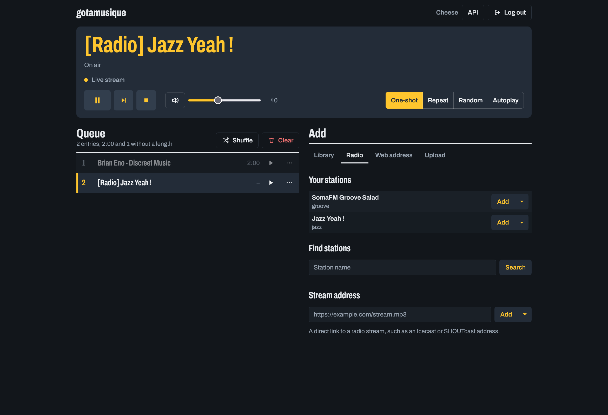

# gotamusique

A Go rewrite of [botamusique](https://github.com/azlux/botamusique), a Mumble music bot.
One self-contained binary, no Python runtime required. The Docker image is fully static.

## Features

- Radio presets, any direct stream URL, HLS streams and [radio-browser.info](https://www.radio-browser.info) search
- Local music library with scan, search, tags, shortlists and bulk queueing (`!file` folders, `!filematch`)
- `!url` / `!playlist` via yt-dlp (best effort: many sites work, YouTube often needs a current yt-dlp and cookies, see [URL playback](commands/index.md#url-playback))
- Playback modes: one-shot, repeat, random, autoplay
- `!pause` / `!resume`, and optional auto-pause when the bot is alone in its channel
- A [web interface](configuration/web.md) (off by default): see what plays, control playback, edit the queue, add stations and tracks, browse and upload music, from a computer or a phone, with an HTTP API and interactive API docs behind it
- Configuration compatible with botamusique's INI schema

## Where to go next

- [Installation](installation.md): binary, Docker, building from source
- [Configuration](configuration/index.md): every INI section and key
- [Commands](commands/index.md): chat command reference
- [Migrating from botamusique](migrating.md)
